# Bài 3 — Bảo mật mạng máy tính

**Họ tên: NGUYỄN PHÚC THỊNH**

**MSSV: 2387700066**

Môn học: Thực hành Lập trình An ninh thông tin. Thực hiện theo `lab-03.pdf`: phần 3.2 SecureChat và phần 3.4 NetRecon.

## 1. Nội dung triển khai

| Yêu cầu | Triển khai | Bằng chứng |
|---|---|---|
| SecureChatServer đa luồng, SSL/TLS | TLS ≥ 1.2; máy thực hành thương lượng TLS 1.3; bắt buộc chứng chỉ client | Chat hai chiều và kiểm tra mTLS |
| SecureChatClient xác minh chứng chỉ | Xác minh CA, thời hạn chứng chỉ và SAN `localhost` / `127.0.0.1`; tên client phải trùng CN chứng chỉ | Từ chối CA lạ, hostname sai, client không có chứng chỉ, giả danh client |
| MessageEncryption | Fernet: AES-128-CBC + HMAC-SHA256; khóa phòng cấp ngoài kênh chat, server không giữ khóa | Tin nhắn tiếng Việt giải mã đúng; khóa sai, dữ liệu sửa đổi và replay trong phiên bị từ chối |
| ConnectionManager | Khóa đồng bộ, giới hạn 64 kết nối, khóa ghi riêng cho từng socket, xóa client khi ngắt | Test trùng danh tính và thu hồi kết nối |
| RoomManager | Nhiều phòng, chuyển phòng, kiểm tra tên phòng, tự xóa phòng rỗng | `general` có Alice/Bob; Charlie ở `private` không nhận tin của `general` |
| PortScanner | TCP Connect và UDP Probe; thêm Nmap TCP Connect / SYN | TCP mở/đóng; UDP phản hồi; adapter SYN có điều kiện Npcap |
| ServiceDetector | Nhận dạng từ phản hồi thật; adapter Nmap `-sV --version-light` | Banner SSH lab, HTTP `LabHTTP/1.0`, báo cáo Nmap |
| BannerGrabber | Timeout, tối đa 4096 byte, loại ký tự điều khiển, Jinja autoescape | Banner hiển thị trong giao diện và báo cáo JSON |
| NetworkMapper | Khám phá TCP trong subnet IPv4 tối đa 16 địa chỉ; kiểm tra policy trước khi khám phá | Sơ đồ scanner → host và danh sách cổng mở |
| VulnChecker | Rủi ro giao thức rõ, thiếu HTTP header, lộ phiên bản; có bằng chứng và khuyến nghị | Phát hiện 2 vấn đề cấu hình của HTTP lab |
| Rate limiting, log, whitelist/blacklist | Giãn thời điểm bắt đầu probe bằng `perf_counter`; JSONL có thời gian UTC; pin IP sau kiểm tra policy | Test giới hạn tốc độ, blacklist và screenshot chặn mục tiêu |
| CLI, Web, email | Click CLI, Flask UI, SMTP STARTTLS cho tài khoản thật; SMTP loopback cho kiểm thử | Ảnh Web, email đã nhận qua SMTP cục bộ |

## 2. Cấu trúc

```text
Buoi3/
├── secure-chat/              # Chat TLS, mã hóa tin nhắn, quản lý client/phòng
│   ├── server.py / client.py
│   ├── message_encryption.py
│   ├── connection_manager.py / room_manager.py
│   ├── protocol.py           # JSON có header độ dài, giới hạn frame 64 KiB
│   ├── make_certs.py / make-certs.bat
│   └── make_room_key.py
├── netrecon/
│   ├── app.py / cli.py / engine.py
│   ├── modules/              # Scanner, banner, service, map, vuln, email, policy, audit
│   ├── templates/ / static/
│   └── .env.example
├── tests/                   # Kiểm thử chức năng và bảo mật
├── screenshots/             # Ảnh chụp thực tế trong quá trình chạy
├── evidence/                # Transcript, báo cáo và kết quả kiểm tra
├── requirements.txt / requirements-dev.txt
└── run_lab.py               # Dựng dịch vụ loopback, demo, test, chụp ảnh
```

Chứng chỉ, private key, khóa phòng, `.env`, dependencies, runtime Nmap và log làm việc được bỏ qua bởi `.gitignore`. Clone repo cần tự sinh lại chứng chỉ và khóa. Không có mật khẩu Gmail hoặc khóa bí mật trong repo.

## 3. Cài đặt và chạy nhanh

Môi trường thực hành: Windows, Python 3.11.9, Google Chrome, Nmap 7.991. Python 3.11+ được hỗ trợ; phần chụp ảnh tự động hiện dùng Chrome tại đường dẫn Windows mặc định.

Từ thư mục gốc repository:

```powershell
cd Buoi3
python -m venv .venv
.\.venv\Scripts\Activate.ps1
python -m pip install -r requirements-dev.txt
python -X utf8 run_lab.py all
```

`all` tạo CA, chứng chỉ server/client và khóa phòng nếu chưa có; dựng dịch vụ; chạy chat mẫu, toàn bộ test; chụp ảnh trong lúc các dịch vụ đang hoạt động; giữ dịch vụ chạy đến khi nhấn Ctrl+C. Không ghi đè PKI hoặc khóa phòng đã tồn tại. Nếu chỉ cần ứng dụng và dịch vụ lab:

```powershell
python -X utf8 run_lab.py serve
```

| Dịch vụ | Địa chỉ | Vai trò |
|---|---|---|
| NetRecon Web | http://127.0.0.1:5000 | Giao diện nhập thông số và xem kết quả |
| SecureChat | `127.0.0.1:8443` | Chat mTLS |
| HTTP lab | `127.0.0.1:8080` | Đích thật phục vụ HTTP, cố ý thiếu header để kiểm tra |
| SSH banner lab | `127.0.0.1:8022` | Socket gửi greeting SSH; không phải SSH server đầy đủ |
| UDP echo | `127.0.0.1:9998` | Trả lời UDP probe |
| SMTP lab | `127.0.0.1:1025` | Nhận email thật qua giao thức SMTP trên loopback |
| Bằng chứng chat / inbox / test | http://127.0.0.1:8090/chat, `/mail`, `/checks` | Hiển thị transcript, mail đã nhận, output kiểm tra |

Kiểm tra mỗi cổng trên máy đang rảnh trước khi chạy; các cổng đích đã xác định ở `run_lab.py`. Tất cả dịch vụ demo bind loopback.

## 4. SecureChat — thao tác thủ công

Không chạy thêm server nếu `run_lab.py serve/all` đã mở cổng 8443. Để chạy riêng:

```powershell
cd secure-chat
python make_certs.py
python make_room_key.py room-keys/general.key
python server.py
```

Mở hai terminal khác, cùng kích hoạt virtual environment và vào `secure-chat`:

```powershell
python client.py --name alice --room general --key-file room-keys/general.key
python client.py --name bob --room general --key-file room-keys/general.key
```

Nhập tin nhắn để chat. Lệnh `/rooms` xem phòng; `/join TEN_PHONG DUONG_DAN_KHOA` chuyển phòng và đổi khóa cục bộ; `/quit` ngắt kết nối. Người trong cùng phòng phải được cấp cùng khóa qua kênh tin cậy, ngoài server chat. Mỗi client dùng chứng chỉ và private key riêng.

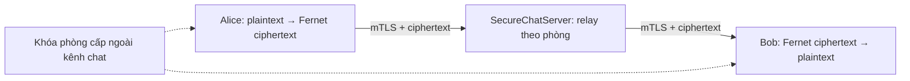

CA tự ký dùng cho lab; server certificate chứa SAN và EKU ServerAuth, client certificate chứa EKU ClientAuth. `make_certs.py` dùng thư viện `cryptography` để sinh PKI trực tiếp, nên không cần sửa PATH OpenSSL toàn hệ thống. Có thể kiểm chứng thêm bằng OpenSSL có sẵn:

```powershell
openssl verify -CAfile certs/ca/ca.crt certs/server/server.crt
openssl x509 -in certs/server/server.crt -noout -text
```

### Ảnh chạy và kết quả

Ảnh dưới là trang bằng chứng lấy **transcript từ client đang kết nối thật** và log từ server, chụp bằng trình duyệt trong lúc thực hiện bài. Thương lượng được `TLSv1.3 / TLS_AES_256_GCM_SHA384`; tin nhắn Unicode giải mã đúng ở hai phía; client Charlie ở phòng khác không nhận được tin. Server chỉ log danh tính, phòng và số byte mã hóa.

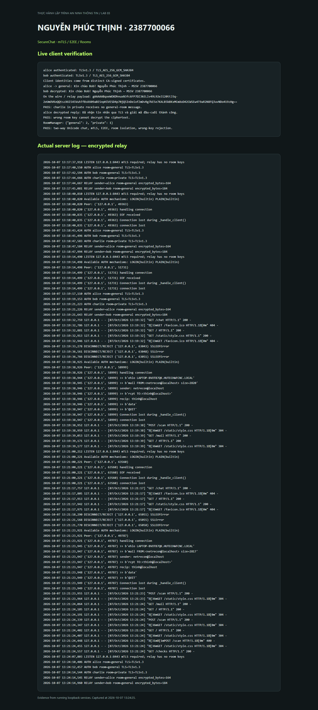

[Transcript gốc](evidence/securechat-transcript.txt).

## 5. NetRecon — CLI và Web

Khi dịch vụ lab đang chạy, mở terminal khác tại `Buoi3`:

```powershell
python netrecon/cli.py --target 127.0.0.1 --ports 8022,8080,8443,9999 --mode all --rate-limit 10 --output evidence/tcp-report.json
python netrecon/cli.py --target 127.0.0.1 --ports 9998,9999 --protocol udp --mode scan --output evidence/udp-report.json
python netrecon/cli.py --target 127.0.0.1 --ports 8080 --mode map --subnet 127.0.0.1/32
```

`--mode`: `scan`, `service`, `banner`, `map`, `vuln`, `all`. `--ports` chấp nhận dấu phẩy hoặc khoảng, tối đa 256 cổng. `--rate-limit` từ 0.5 đến 100 lần/giây. Map thăm dò tối đa 8 cổng trên mỗi địa chỉ. Phiên Web được tuần tự hóa trong một tiến trình; phiên đang chạy sẽ chặn yêu cầu đồng thời khác.

`TargetPolicy` kiểm tra toàn bộ IPv4 được DNS trả về, áp dụng blacklist trước khi cho phép và truyền **IP đã kiểm tra** xuống các mô-đun để tránh DNS đổi mục tiêu sau bước xác minh. Mặc định chỉ cho phép `127.0.0.0/8`. Cấu hình `.env` để mở rộng phạm vi mạng lab khi cần; không dùng hostname cho whitelist/blacklist, chỉ IP/CIDR.

Log hoạt động: `netrecon/logs/netrecon.jsonl`, gồm bắt đầu/kết quả từng probe, lấy banner, Nmap, mapping, email và từ chối yêu cầu. Thời gian dùng UTC. Banner không được thực thi; HTML hiển thị được escape. Web có CSRF token, giới hạn request, kiểm tra Host và security headers.

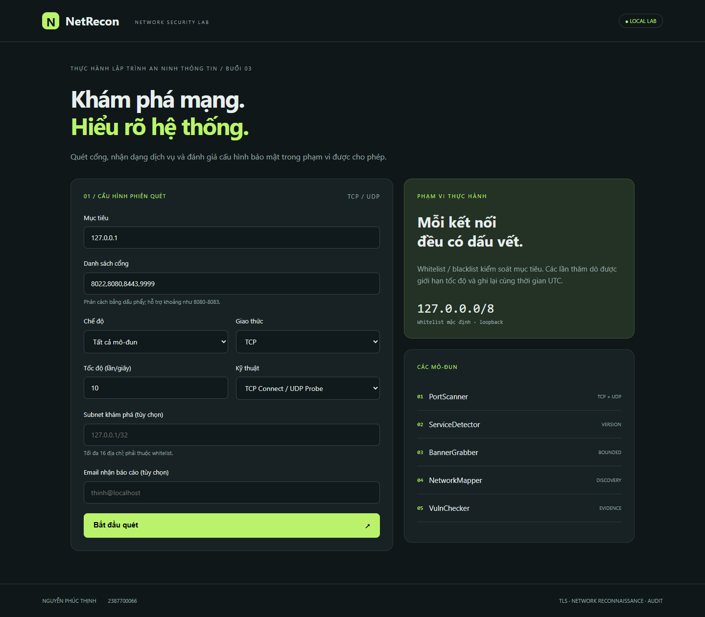

### TCP, banner, nhận dạng dịch vụ, kiểm tra cấu hình và mapping

Kết quả lab: `8022`, `8080`, `8443` mở; `9999` đóng. Nhận dạng greeting SSH lab và HTTP `LabHTTP/1.0`. Cổng chat mTLS không trả banner rõ qua socket plaintext nên giữ `unknown`. HTTP lab cho hai phát hiện: thiếu `X-Content-Type-Options` và lộ phiên bản server. Sơ đồ thể hiện các host có thể tiếp cận từ scanner, không suy ra kết nối vật lý của mạng.

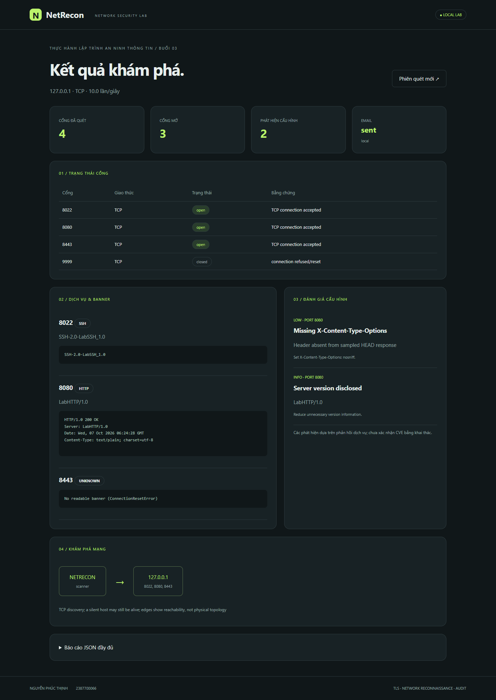

### UDP

`9998/udp` mở vì nhận được phản hồi từ UDP echo. Với UDP, im lặng được ghi `open|filtered`, không coi timeout là bằng chứng cổng đóng. Trạng thái `closed` cần phản hồi từ chối/reset của hệ điều hành.

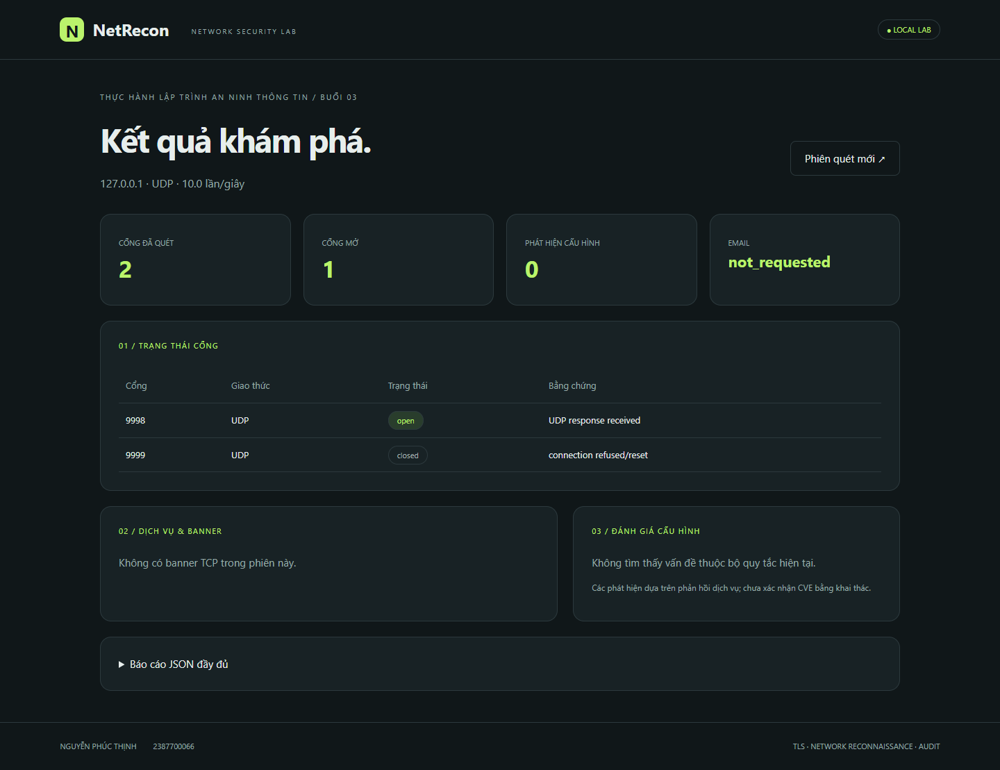

### Kiểm tra giới hạn phạm vi

Gửi yêu cầu đến `192.0.2.1` bị policy chặn trước khi scanner kết nối. Blacklist ghi đè whitelist; có kiểm thử tự động cho cả hai.

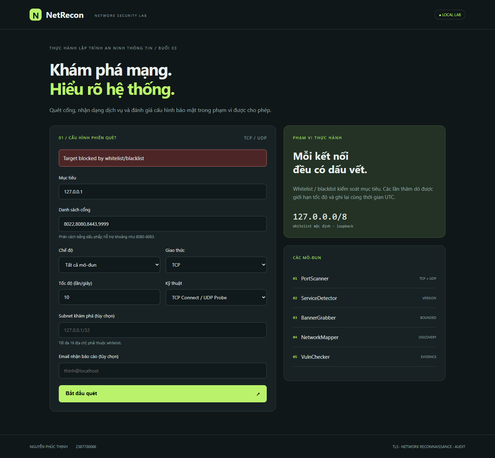

### Nmap và kỹ thuật SYN

Cài [Nmap từ trang chính thức](https://nmap.org/download.html), thêm PATH hoặc cấu hình `NMAP_PATH` trong `.env`. Máy thực hành dùng bản Nmap 7.991 trích xuất vào `runtime/nmap` từ bộ cài chính thức, không đưa binary vào Git. `run_lab.py` tự nhận đường dẫn này nếu có.

```powershell
$env:NMAP_PATH = 'C:\duong-dan\nmap.exe'
python netrecon/cli.py --target 127.0.0.1 --ports 8022,8080,9999 --mode all --technique nmap-connect --output evidence/nmap-report.json
python netrecon/cli.py --target 127.0.0.1 --ports 8080 --mode scan --technique syn
```

Adapter dùng danh sách đối số, không dùng shell; target IPv4, ports và rate được kiểm tra, kết quả XML dùng `defusedxml`, có timeout 40 giây. Nmap hỗ trợ `-sT` hoặc `-sS`, `-sV --version-light`, `--max-rate`, giới hạn retry và host timeout.

**Kết quả đã kiểm chứng:** Nmap TCP Connect chạy thật và được chụp ảnh; SYN được triển khai trong adapter nhưng **chưa chạy thành công trên máy này do thiếu Npcap/raw packet support**. Windows cần Npcap và quyền phù hợp để chạy SYN. Không gọi TCP Connect là kỹ thuật vô hình; SYN cũng có thể bị phát hiện. `--max-rate` của Nmap giới hạn pha quét cổng; lưu lượng pha nhận dạng phiên bản không có bảo đảm tốc độ giống bộ scanner Python. Nếu cần giới hạn chính xác từng lần kết nối, dùng `--technique connect`.

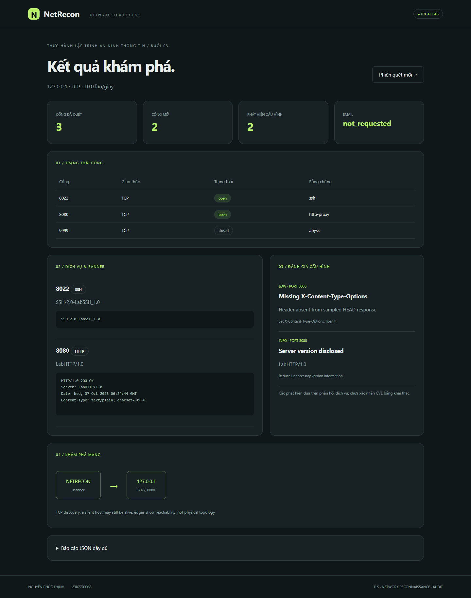

[Báo cáo Nmap JSON](evidence/nmap-report.json). Nhãn service Nmap có thể suy đoán từ bảng cổng, cần đọc trường `method/conf` và đối chiếu banner; tên `http-proxy` ở cổng 8080 không chứng minh đích là proxy.

## 6. Gửi email báo cáo

Trong demo, nhập `thinh@localhost`. Ứng dụng thực sự kết nối SMTP `127.0.0.1:1025`, gửi thư bằng `smtplib`, và dịch vụ SMTP lưu lại thư nhận được. Screenshot có người gửi, người nhận, subject và nội dung báo cáo. Đây là **hộp thư SMTP lab cục bộ**, không phải ảnh Gmail hoặc thư đã gửi ra Internet.

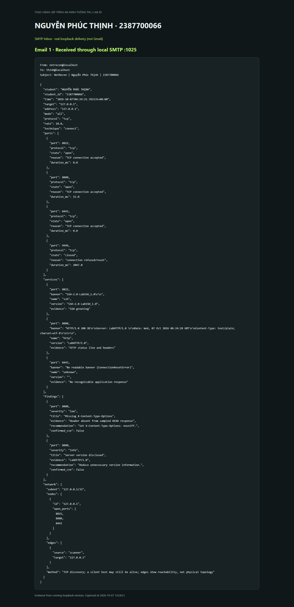

[Email đã nhận](evidence/smtp-delivery.json).

Để dùng Gmail, sao chép `netrecon/.env.example` thành `netrecon/.env` và cấu hình tại máy cá nhân:

```dotenv
SMTP_MODE=starttls
SMTP_HOST=smtp.gmail.com
SMTP_PORT=587
SMTP_USER=<dia-chi-gmail-cua-ban>
SMTP_PASS=<mat-khau-ung-dung-cua-ban>
WHITELIST=127.0.0.0/8
BLACKLIST=
```

Khởi động riêng `python netrecon/app.py` sau khi cấu hình; **runner demo luôn chọn SMTP local**, phục vụ việc kiểm thử có thể tái lập. Gmail chưa được kiểm thử vì không có tài khoản/mật khẩu ứng dụng được cung cấp. Nếu email chưa cấu hình hoặc gửi thất bại, báo cáo vẫn giữ kết quả scan và hiển thị trạng thái tương ứng. Không in thông tin đăng nhập vào log hoặc đưa `.env` lên GitHub.

## 7. Kiểm thử và bằng chứng

```powershell
python -X utf8 run_lab.py test
python -m bandit -r secure-chat netrecon
```

Kết quả cuối: **44/44 test PASS**. Các trường hợp bao gồm mã hóa Unicode, khóa sai, tamper, replay, frame TCP phân mảnh, frame quá lớn, TLS hai chiều, phòng riêng, từ chối chứng chỉ thiếu/CA lạ/hostname sai/giả danh, quản lý kết nối, kiểm tra input, whitelist/blacklist, giới hạn tốc độ nối tiếp và đồng thời, TCP/UDP thật, banner giới hạn, fingerprinting, mapping giới hạn, email header injection, CSRF, DNS rebinding, XML entity và Nmap timeout. Các test adapter Nmap dùng phản hồi có kiểm soát; kiểm chứng Nmap thực tế nằm trong báo cáo riêng ở trên.

Bandit: **0 findings** cho `secure-chat` và `netrecon`; hai kiểm tra subprocess mức thấp được loại trừ tại dòng cụ thể với lý do cố định executable, đối số đã xác minh và không dùng shell. XML entity được chặn bằng `defusedxml`.

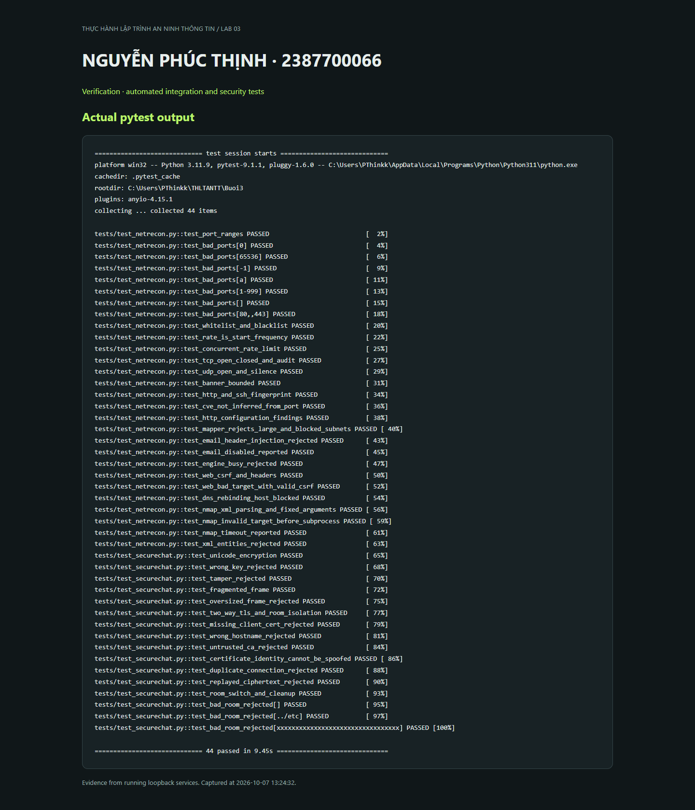

[Output pytest](evidence/test-results.txt) · [Báo cáo Bandit](evidence/bandit.json).

### Chạy lại trực tiếp trong CMD Windows

Ngày 07/10/2026, mở CMD và chạy lại các lệnh dưới đây trên máy thực hành. Sáu ảnh được chụp trực tiếp cửa sổ CMD sau khi dịch vụ khởi động hoặc lệnh hoàn thành. Tiêu đề cửa sổ ghi tên sinh viên không dấu để hiển thị ổn định; output Python dùng UTF-8.

**Khởi động dịch vụ lab** — `python -X utf8 run_lab.py serve`: server chat mTLS và các dịch vụ đích sẵn sàng trên loopback.

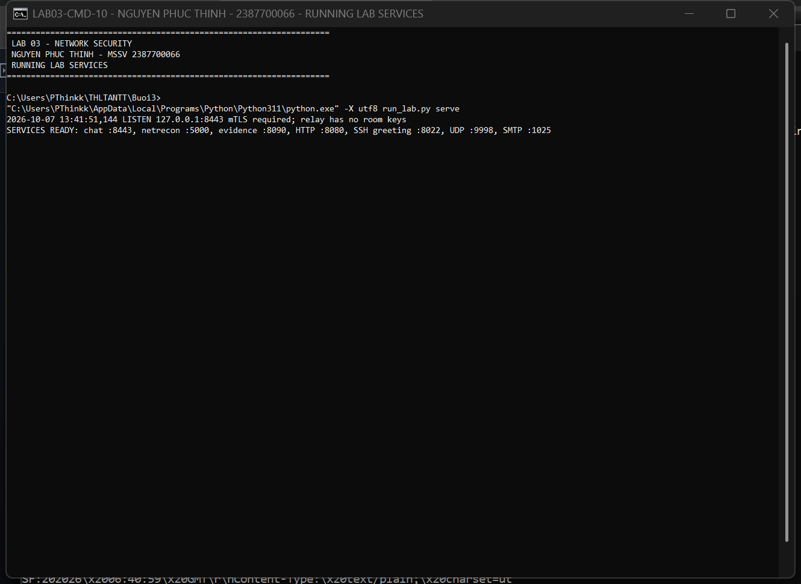

**Chat hai chiều** — `python -X utf8 run_lab.py demo`: TLS 1.3, giải mã tin nhắn tiếng Việt, phòng riêng không nhận tin và khóa sai bị từ chối; exit code 0.

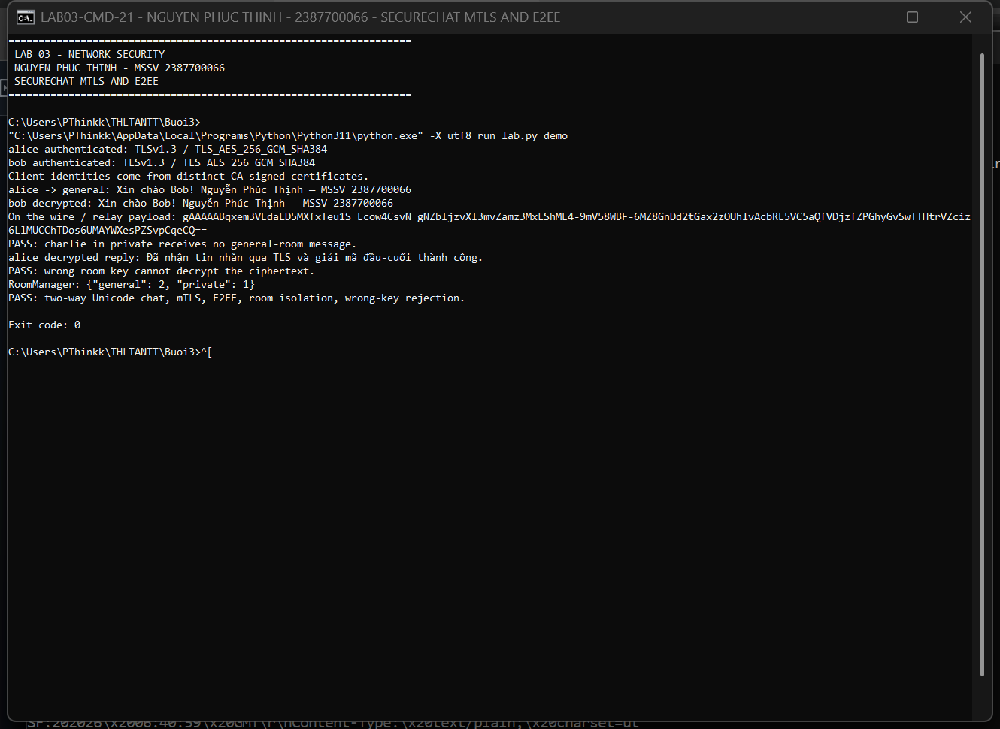

**Quét TCP** — `python netrecon/cli.py --target 127.0.0.1 --ports 8080,9999 --mode scan --rate-limit 10`: `8080/tcp` mở, `9999/tcp` đóng.

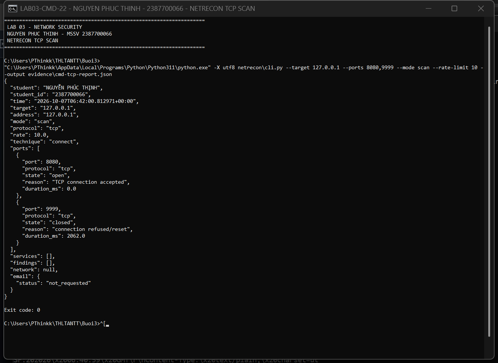

**Quét UDP** — `python netrecon/cli.py --target 127.0.0.1 --ports 9998,9999 --protocol udp --mode scan`: `9998/udp` phản hồi, `9999/udp` bị hệ điều hành từ chối.

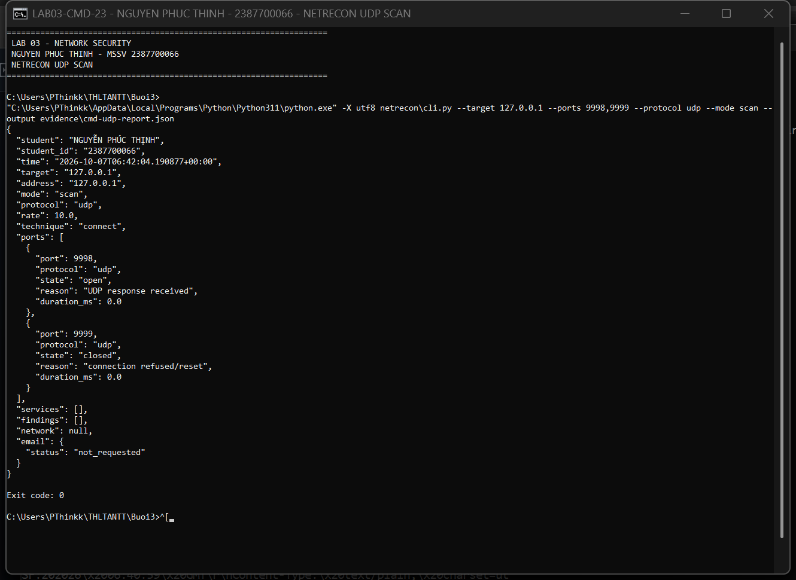

**Kiểm thử và rà soát mã nguồn** — `python -m pytest tests -q` và `python -m bandit -r secure-chat netrecon`: 44 test PASS; Bandit không phát hiện vấn đề.

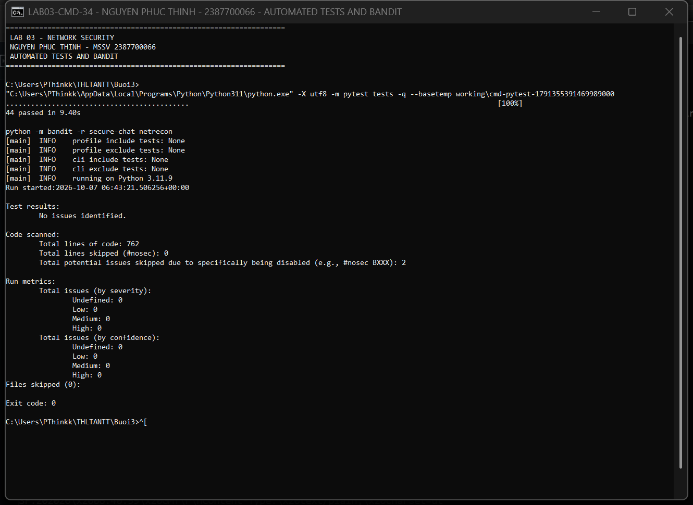

**Nmap chạy trực tiếp** — `nmap -sT -Pn -n -sV --version-light --max-rate 10 --host-timeout 30s -p 8022,9999 127.0.0.1`: nhận dạng greeting SSH ở cổng 8022, cổng 9999 đóng; exit code 0. Cảnh báo thiếu Npcap vẫn hiển thị trong ảnh, TCP Connect tiếp tục chạy được.

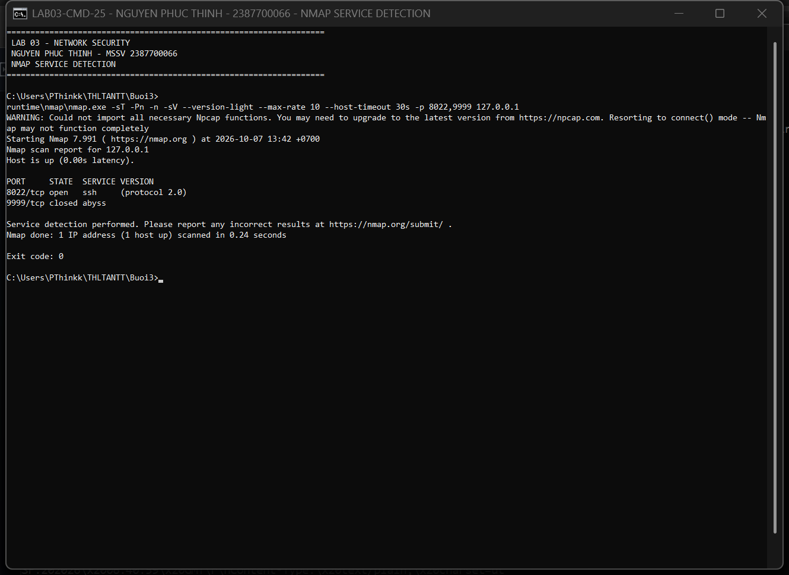

[Báo cáo TCP từ lần chạy CMD](evidence/cmd-tcp-report.json) · [Báo cáo UDP từ lần chạy CMD](evidence/cmd-udp-report.json).

## 8. Phạm vi bảo mật của bài thực hành

E2EE dùng khóa chia sẻ của nhóm: các thành viên giữ khóa có thể đọc và tạo ciphertext hợp lệ; danh tính người gửi được server gắn từ chứng chỉ client, chưa có chữ ký riêng cho từng tin nhắn. Không có ratchet hoặc forward secrecy ở lớp Fernet, không có cơ chế đổi khóa tự động khi thành viên rời phòng. Cache chống replay thuộc phiên client hiện tại. Tên phòng và danh tính thành viên vẫn thấy được ở server. Phòng tách luồng chuyển tiếp, chưa có ACL mời tham gia riêng.

TLS kiểm tra trust chain, thời hạn và hostname; bài chưa triển khai CRL/OCSP tự động. Private key sinh không mã hóa phục vụ demo và chỉ lưu cục bộ. Với triển khai thật cần bổ sung bảo vệ private key, thu hồi chứng chỉ và quy trình cấp/đổi khóa.

VulnChecker cung cấp các dấu hiệu cấu hình, **không kết luận một CVE chỉ từ số cổng** và không khai thác lỗ hổng. NetworkMapper chỉ phát hiện host trả lời trên các cổng được chọn; host im lặng có thể vẫn hoạt động.

## 9. Đối chiếu tài liệu

- `lab-03.pdf`: trang 3–14 (SecureChat), trang 15–29 (NetRecon).
- [Nmap: tài liệu quét và tham số](https://nmap.org/book/man.html).
- [Nmap trên Windows và điều kiện Npcap](https://nmap.org/book/inst-windows.html).
- [Python ssl: xác minh chứng chỉ và hostname](https://docs.python.org/3/library/ssl.html).
- [Fernet: thuật toán và giới hạn](https://cryptography.io/en/latest/fernet/).

Các cải tiến so với mã minh họa trong PDF: SAN/EKU đúng mục đích, mTLS bắt buộc, cấp khóa E2EE ngoài relay, JSON có framing, không tắt xác minh chứng chỉ, đo rate bằng tần suất bắt đầu probe thay vì chỉ đếm concurrency, pin IP, kiểm tra scope cho mapping, không hard-code CVE theo cổng, SMTP đọc cấu hình cục bộ, Flask không bật debug và có CSRF/Host validation.
