# Lab 04 — Bảo mật Web App và API

**Sinh viên:** Nguyễn Phúc Thịnh
**MSSV:** 2387700066
**Môn học:** Thực hành Lập trình An ninh thông tin
**Đề bài:** `lab-04.pdf`, 29 trang; thực hành mục 4.2 và 4.4.
**Ngày thực hiện:** 13/10/2026.

Đã xây dựng **WebVulnScanner** và **JWTSecure**, chạy dịch vụ thật trên loopback, kiểm thử HTTP và trình duyệt, chụp **15 ảnh**, trong đó có **7 ảnh cửa sổ Windows CMD**. Kết quả: **25 unittest scanner + 35 pytest JWT = 60 test đạt**; kiểm thử tích hợp đạt; Bandit không còn finding trong phạm vi đã cấu hình. Hai warning của pytest đến từ việc cố ý tạo khóa yếu trong test JWTCracker.

[Báo cáo phân tích và đối chiếu đề](REPORT.md) · [Kết quả HTTP](evidence/integration.json) · [Kiểm tra trình duyệt](evidence/browser-checks.json) · [Danh mục ảnh và SHA-256](evidence/screenshot-manifest.json).

## 1. Cấu trúc

```text
Buoi4/
├── web-vuln-scanner/
│   ├── scanners/       # XSSScanner, SQLInjectionTester, CSRFDetector, SSRFTester
│   ├── report/         # ReportGenerator
│   ├── tests/          # unittest và test Web UI
│   ├── ui/templates/   # Flask Web UI; escape payload khi hiển thị
│   ├── engine.py
│   ├── main.py
│   └── requirements.txt
├── jwt-security-tools/
│   ├── api_gateway/
│   ├── jwt_cracker/
│   ├── jwt_validator/
│   ├── oauth_client/
│   ├── token_manager/
│   ├── tests/
│   ├── main.py
│   ├── pytest.ini
│   └── requirements.txt
├── lab_target.py        # Fixture có lỗ hổng và fixture đã khắc phục
├── run_lab.py           # Khởi động 5 dịch vụ; chạy demo HTTP
├── tools/               # Kiểm thử, chụp CMD/Chrome thực tế
├── evidence/            # Log, JSON, JUnit XML; không chứa token
├── screenshots/         # 15 ảnh thao tác thực tế
├── requirements*.txt
└── REPORT.md
```

`runtime/`, `working/`, `.venv/`, khóa JWT, token, DB refresh và file cấu hình curl bị loại khỏi Git. `runtime` được sinh lại khi chạy.

## 2. Cài đặt và khởi động

Đã chạy trên Windows với Python 3.11.9 và Google Chrome. Phần ứng dụng cần Python 3.11+; chụp CMD dùng Win32 nên cần Windows. Các dependency chính: Flask, requests, PyJWT, BeautifulSoup; dependency kiểm thử: pytest, Playwright, Pillow, Bandit. [requirements-lock.txt](requirements-lock.txt) lưu phiên bản chính xác trong lần thực hành này.

Tại thư mục gốc repository, mở CMD:

```bat
cd Buoi4
python -m venv .venv
.venv\Scripts\python.exe -m pip install -r requirements-dev.txt
.venv\Scripts\python.exe -X utf8 run_lab.py serve
```

Giữ CMD này mở, dùng một CMD khác chạy các bước tiếp theo. Mỗi cổng phải còn trống. Chương trình không tự dừng dịch vụ khác trên máy.

| Dịch vụ | Địa chỉ |
|---|---|
| WebVulnScanner UI | http://127.0.0.1:5100/ |
| JWT API Gateway | http://127.0.0.1:5101/protected |
| Ứng dụng có lỗ hổng / đối chứng | http://127.0.0.1:5102/ |
| Dịch vụ marker nội bộ | http://127.0.0.1:5103/internal-proof |
| OAuth Authorization Code + PKCE fixture | http://127.0.0.1:5104/authorize |

Cổng khác ví dụ 5000 trong đề để hai bài chạy đồng thời, không xung đột. HTTP chỉ phục vụ loopback trong lab. `jwt-security-tools/main.py` vẫn chạy độc lập ở cổng 5000 theo đề; không chạy thêm nó nếu đã mở cùng gateway qua runner.

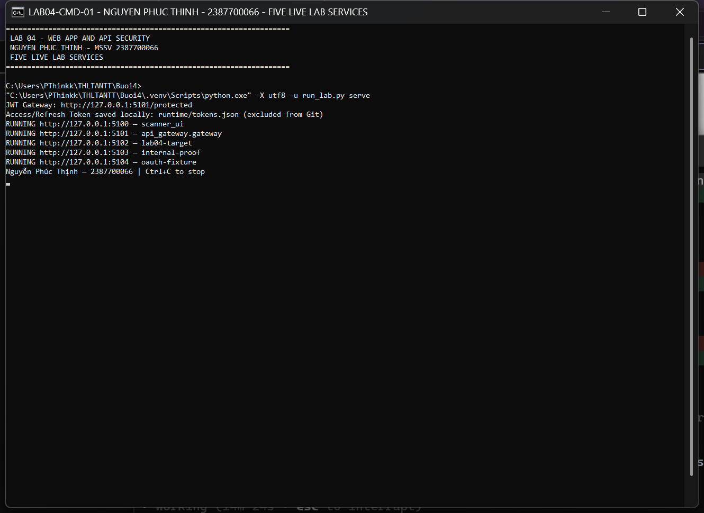

## 3. WebVulnScanner — CLI

```bat
.venv\Scripts\python.exe -X utf8 web-vuln-scanner\main.py --url "http://127.0.0.1:5102/page?id=1" --scanners xss csrf --summary
.venv\Scripts\python.exe -X utf8 web-vuln-scanner\main.py --url "http://127.0.0.1:5102/items?id=1" --scanners sql --summary --output evidence\cmd-sql-report.json
.venv\Scripts\python.exe -X utf8 web-vuln-scanner\main.py --url "http://127.0.0.1:5102/fetch?url=" --scanners ssrf --summary
```

Scanner chỉ gửi HTTP đến `127.0.0.1:5102`, không follow redirect và không dùng proxy từ môi trường. Giới hạn 8 tham số, 512 KB/response và timeout. Không gửi payload DROP/DELETE. Sai phạm vi bị chặn trước khi gửi HTTP.

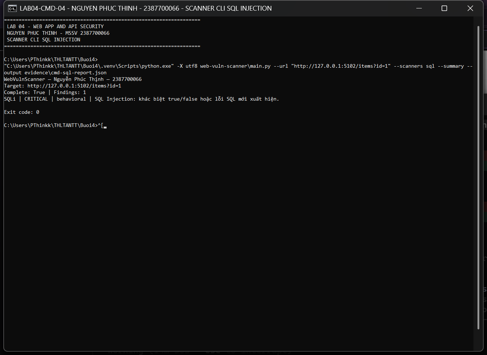

## 4. WebVulnScanner — Web UI

Mở http://127.0.0.1:5100/, nhập URL lab, chọn scanner và bấm **Bắt đầu kiểm thử**. Form UI có CSRF token; báo cáo escape payload và có CSP để không thực thi payload scanner phát hiện được.

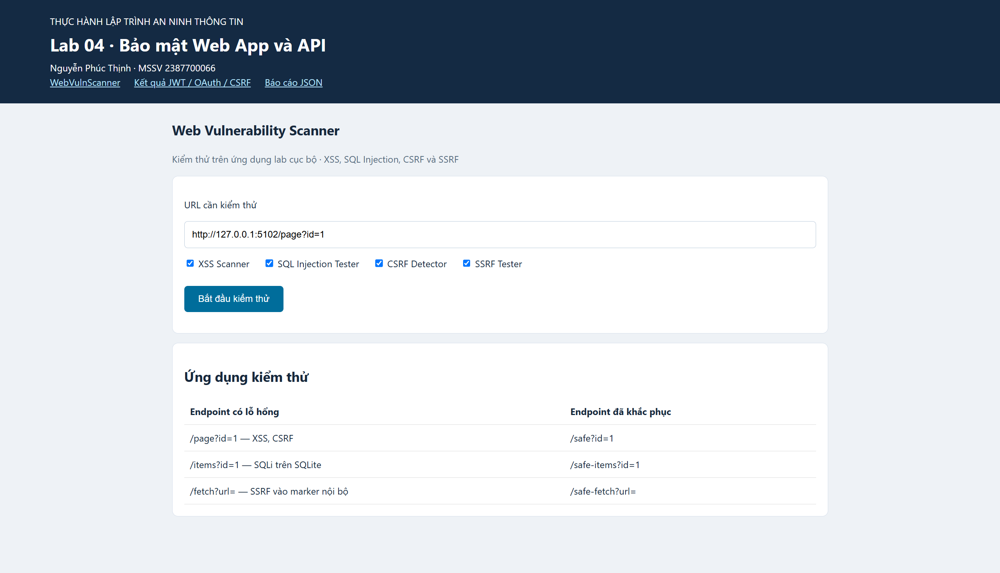

### XSS và CSRF

`/page?id=1`: hai payload XSS phản chiếu nguyên dạng và một form POST thiếu token. Scanner ghi XSS là `candidate`, CSRF là `indicator`; kiểm tra trình duyệt bổ sung xác nhận script `alert(1)` thực thi trên fixture. POST không có CSRF token được fixture chấp nhận với HTTP 200, còn `/safe-change` trả 403. Đây là kiểm tra cơ chế phía server; không tuyên bố đã mô phỏng đầy đủ hành vi cross-site của cookie trong mọi trình duyệt.

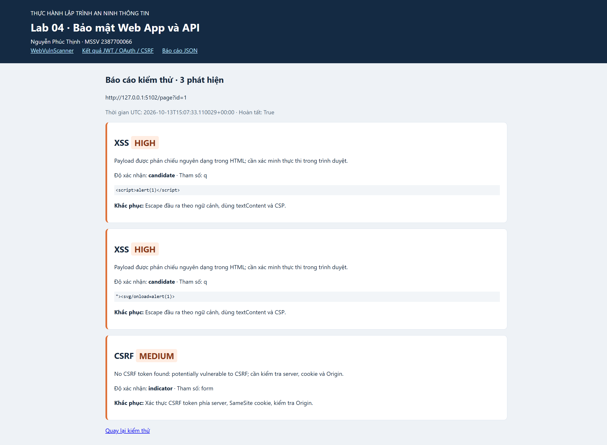

### SQL Injection

`/items?id=1`: truy vấn SQLite ghép chuỗi. Probe `1 OR 1=1` trả hai hàng, `1 AND 1=2` trả không có hàng; baseline trả một hàng. Probe dấu nháy tạo lỗi SQLite. `/safe-items` dùng bind parameter và không có phát hiện.

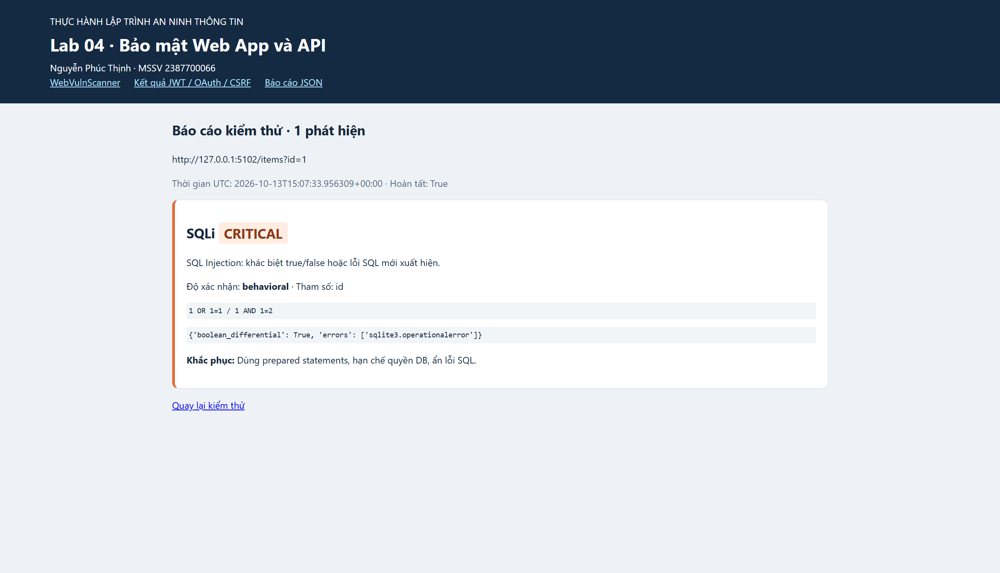

### SSRF

`/fetch?url=`: scanner yêu cầu server lấy marker từ dịch vụ nội bộ 5103 và kiểm tra marker trong phản hồi. Fixture chỉ cho phép đúng URL marker lab; không cho phép dùng nó để truy cập tài nguyên tùy ý trên máy.

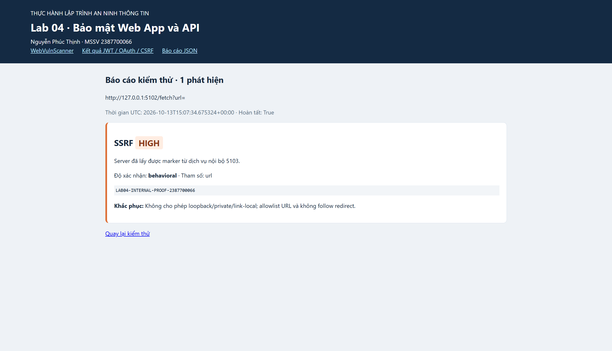

### Đối chứng và kiểm tra phạm vi

`/safe`, `/safe-items`, `/safe-fetch` cho 0 phát hiện trong phạm vi các probe đã thực hiện. Kết quả này không thay thế kiểm toán đầy đủ. Mục tiêu ngoài lab `192.0.2.1` bị từ chối.

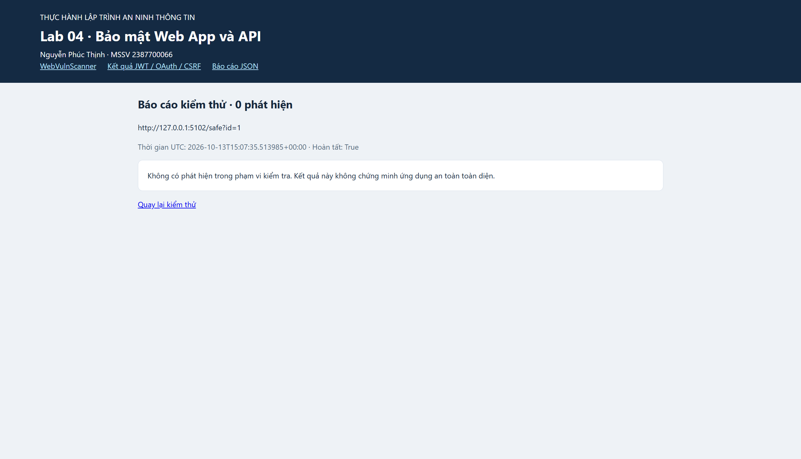
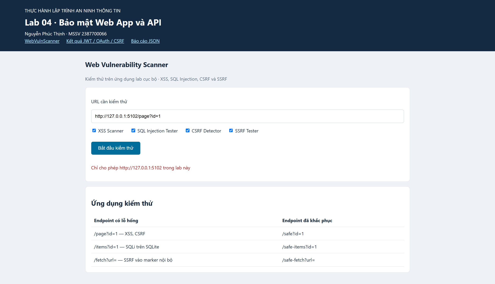

## 5. JWTSecure — JWT, OAuth và vòng đời token

JWTValidator chỉ nhận HS256, yêu cầu `sub`, `exp`, `iat`, `nbf`, `iss`, `aud`, `jti`, `type`, xác minh chữ ký và loại access token. TokenManager sinh access token 15 phút, refresh token 24 giờ; lưu **SHA-256 của refresh token** trong SQLite, rotate atomically và thu hồi refresh token. Khóa gateway được sinh ngẫu nhiên, tối thiểu 32 bytes.

OAuthClient triển khai Authorization Code + PKCE S256, state ngẫu nhiên, timeout và state dùng một lần. Trao đổi code được kiểm tra với OAuth provider fixture cục bộ. JWTCracker chỉ thử offline chữ ký HS256 theo wordlist có giới hạn; demo dùng token yếu do bài tự tạo.

API có rate limit 60 request/phút theo địa chỉ, `Cache-Control: no-store` và audit log chỉ ghi thời gian, method, path, status; không ghi Authorization/token/body. Rate limit lưu trong bộ nhớ một tiến trình, chưa dành cho gateway phân tán.

```bat
.venv\Scripts\python.exe -X utf8 run_lab.py demo
curl.exe --config runtime\access.curl http://127.0.0.1:5101/protected
curl.exe http://127.0.0.1:5101/protected
curl.exe -H "Authorization: Bearer invalid-lab-token" http://127.0.0.1:5101/protected
```

File `runtime/access.curl` chứa Authorization header của access token được sinh thật; curl gửi header như lệnh `curl -H` trong đề, tránh đưa token vào ảnh công khai. Access/refresh token đầy đủ được lưu riêng ở `runtime/tokens.json`. Sau khi demo chạy, runner cấp lại token cho thao tác CMD, vì refresh token cũ đã bị rotate/thu hồi trong demo.

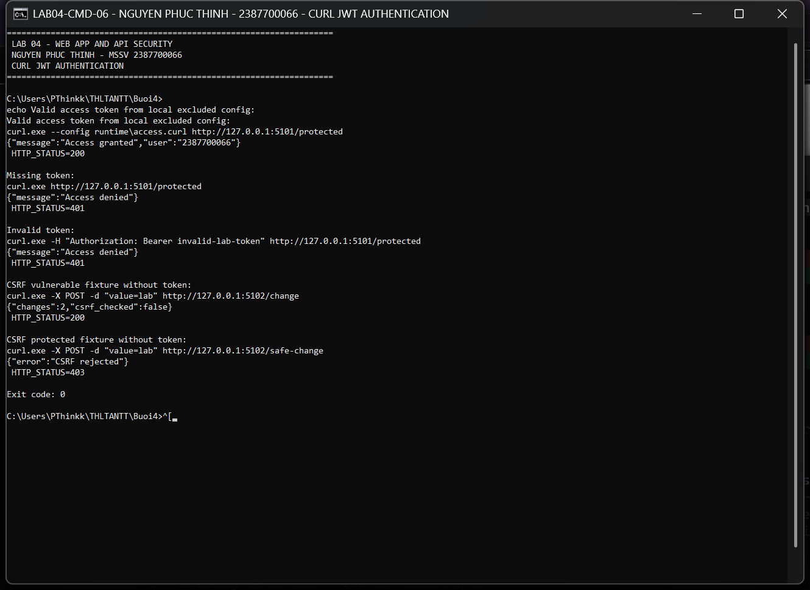
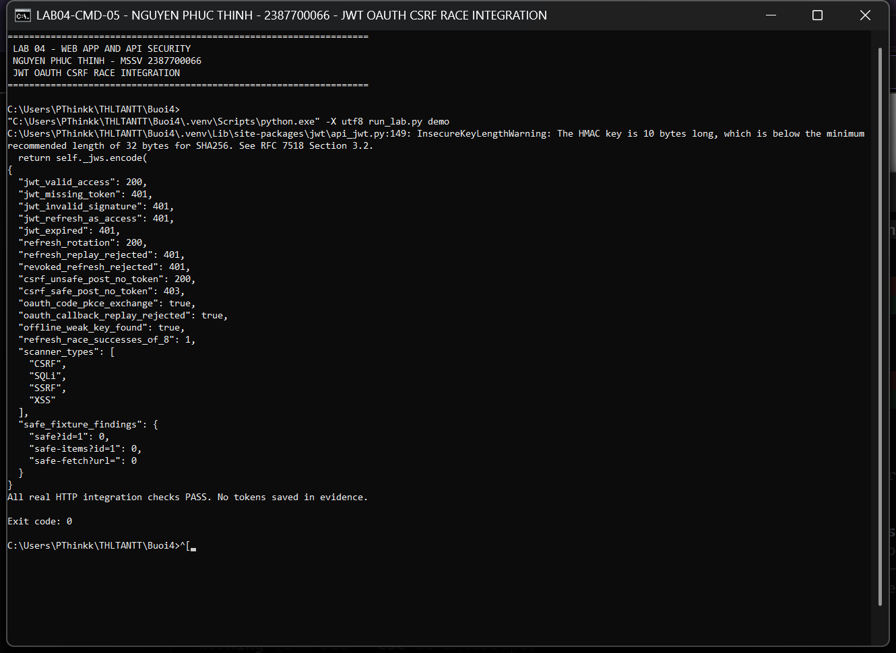
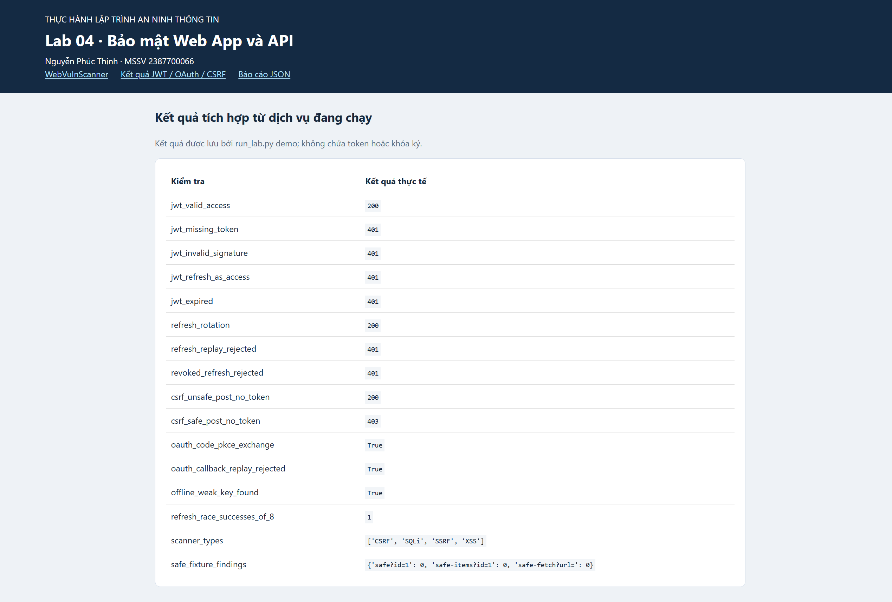

## 6. Kiểm thử và rà soát

```bat
.venv\Scripts\python.exe -X utf8 tools\validate.py
```

Script chạy unittest scanner, pytest JWT, Bandit và lưu output vào `evidence`. Có thể chạy riêng theo đề:

```bat
cd web-vuln-scanner
..\.venv\Scripts\python.exe -m unittest discover tests
cd ..\jwt-security-tools
..\.venv\Scripts\python.exe -m pytest tests --basetemp ..\working\pytest-manual
```

Với pytest, dùng thư mục `--basetemp` mới cho mỗi lần chạy nếu muốn giữ dữ liệu lần trước; pytest có thể làm sạch thư mục tạm được chỉ định.

| Kiểm tra | Kết quả / bằng chứng |
|---|---|
| Scanner unittest | 25/25 — [output](evidence/scanner-unittest.txt) |
| JWT pytest | 35/35 — [output](evidence/jwt-pytest.txt), [JUnit XML](evidence/jwt-tests.xml) |
| HTTP JWT/CSRF/OAuth/SSRF/SQLi | Đạt — [integration.json](evidence/integration.json) |
| Trình duyệt, XSS thật, UI CSRF, phạm vi | Đạt — [browser-checks.json](evidence/browser-checks.json) |
| Bandit | 0 finding — [JSON](evidence/bandit.json) |
| Audit API đã lọc | [gateway-audit.jsonl](evidence/gateway-audit.jsonl) |

Bandit bỏ qua thư mục test. Có suppression được ghi rõ tại dòng SQL cố ý có lỗ hổng trong fixture (`B608`) và chuỗi tên scheme `Bearer` bị nhận nhầm là credential (`B105`); kết quả 0 finding không có nghĩa fixture đã an toàn. Hai warning khóa yếu là bằng chứng chủ đích của test cracker, không phải khóa của gateway.

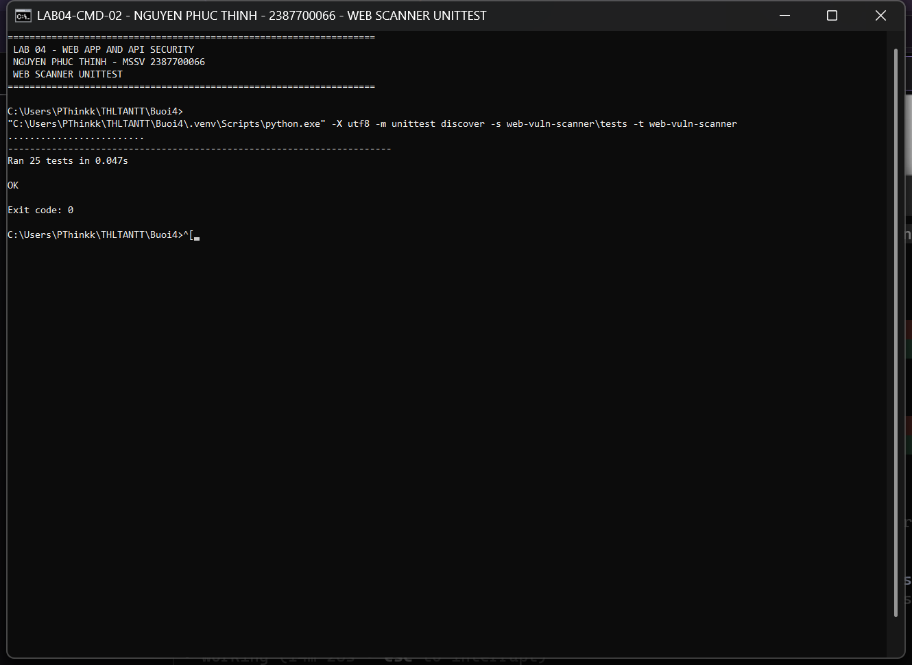
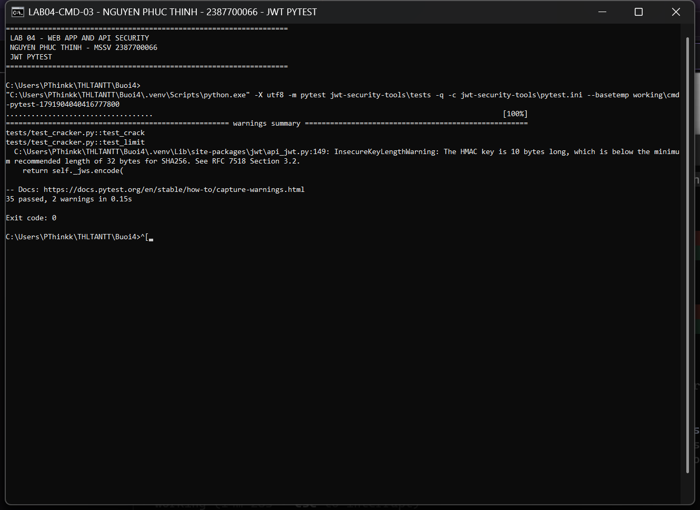
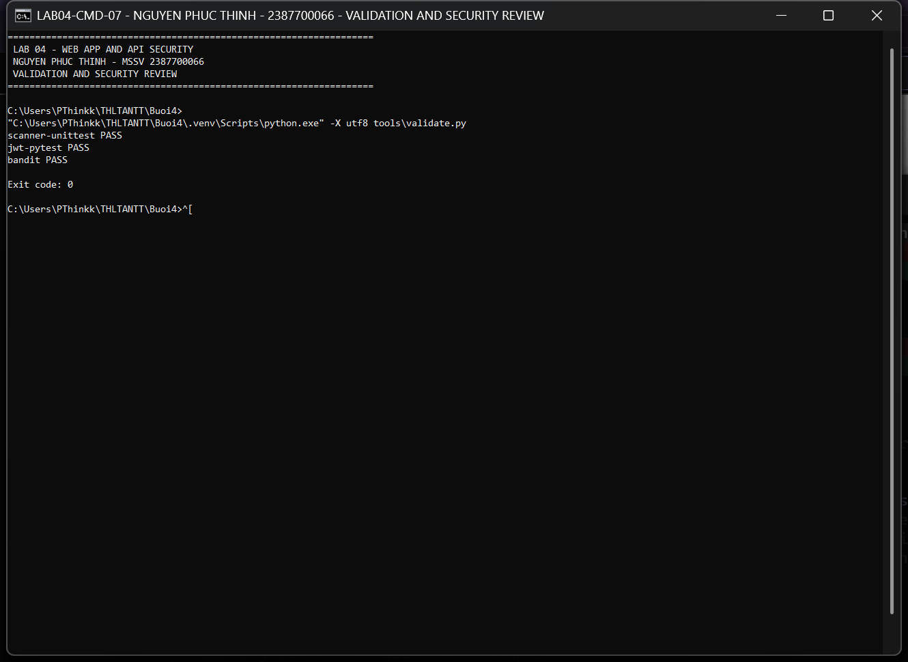

## 7. Tự động chụp ảnh như Buoi3

Sau khi cài Google Chrome và dependency dev, tại `Buoi4`:

```bat
.venv\Scripts\python.exe -X utf8 tools\capture_all.py
```

Script mở CMD thật bằng `conhost.exe`, chạy lệnh và đợi exit code; chụp vùng cửa sổ bằng Windows ImageGrab. Sau đó mở Chrome có giao diện, thao tác form, chụp Web UI bằng Playwright và chụp toàn màn hình khi Chrome ở phía trước. Không tạo ảnh terminal giả và không chỉnh sửa nội dung ảnh. Script cần 5 cổng lab trống; nếu đã mở runner thủ công, dừng đúng CMD runner đó trước khi chạy script. Cửa sổ dịch vụ do script mở được giữ chạy để xem bài; đóng cửa sổ đó hoặc Ctrl+C để dừng.

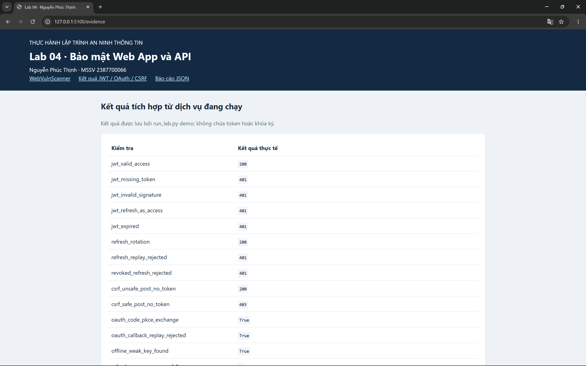

## 8. Phạm vi và giới hạn đã xác định

- XSSScanner kiểm tra reflected XSS; chưa crawl stored XSS hoặc phân tích DOM sink toàn diện.
- SQL scanner có thư viện mẫu cho SQLite/MySQL/PostgreSQL/MSSQL; thực nghiệm HTTP ở bài này xác minh **SQLite**, chưa dựng ba DBMS còn lại. Static `scan()` chỉ nhận diện mẫu; `probe()` kiểm tra hành vi baseline/true/false và lỗi SQL.
- Thiếu CSRF token là dấu hiệu; token có mặt không chứng minh server xác thực đúng. Fixture bổ sung có test POST phía server và UI có test CSRF riêng.
- SSRF test dùng marker cục bộ; chưa triển khai DNS/OOB/blind SSRF và không thử cloud metadata thật.
- OAuth provider là fixture mô phỏng cấp code có PKCE; chưa kết nối nhà cung cấp ngoài hoặc triển khai OIDC/id_token validation.
- Thu hồi refresh token không lập tức vô hiệu access token đã phát hành; access token còn hiệu lực đến `exp` (15 phút).
- API là gateway lab, chưa có giao diện đăng nhập người dùng, RBAC, TLS public hoặc rate limiting nhiều instance. Dịch vụ được bind loopback.

## 9. Tài liệu tham khảo

Escape đầu ra theo ngữ cảnh và parameterized queries được đối chiếu với [OWASP XSS Prevention](https://cheatsheetseries.owasp.org/cheatsheets/Cross_Site_Scripting_Prevention_Cheat_Sheet.html) và [OWASP SQL Injection Prevention](https://cheatsheetseries.owasp.org/cheatsheets/SQL_Injection_Prevention_Cheat_Sheet.html). Các lựa chọn state/PKCE và kiểm tra thuật toán/claim JWT tham khảo [RFC 9700](https://www.rfc-editor.org/rfc/rfc9700.html) và [RFC 8725](https://www.rfc-editor.org/rfc/rfc8725.html).
