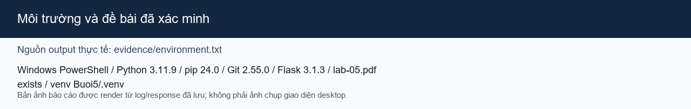
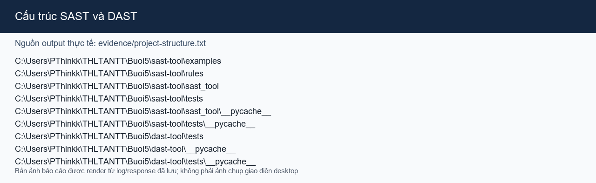
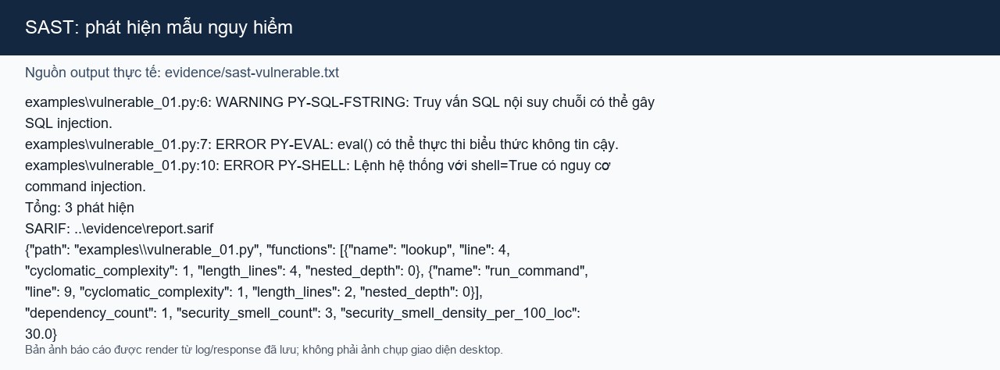
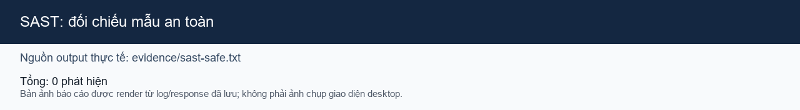
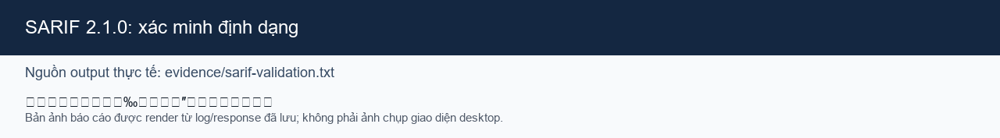
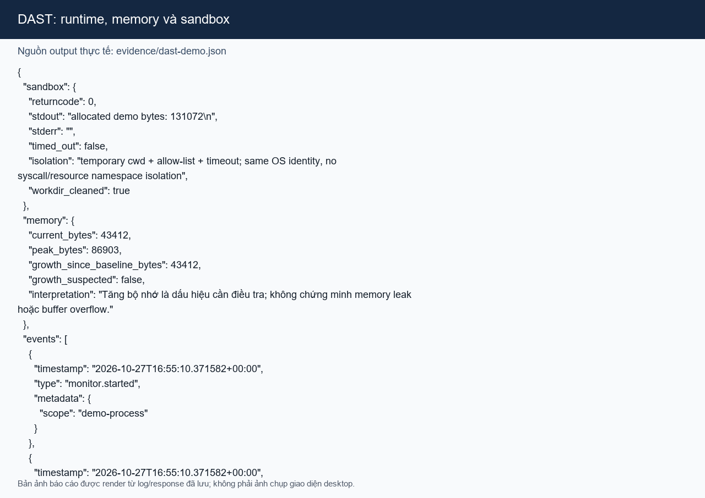
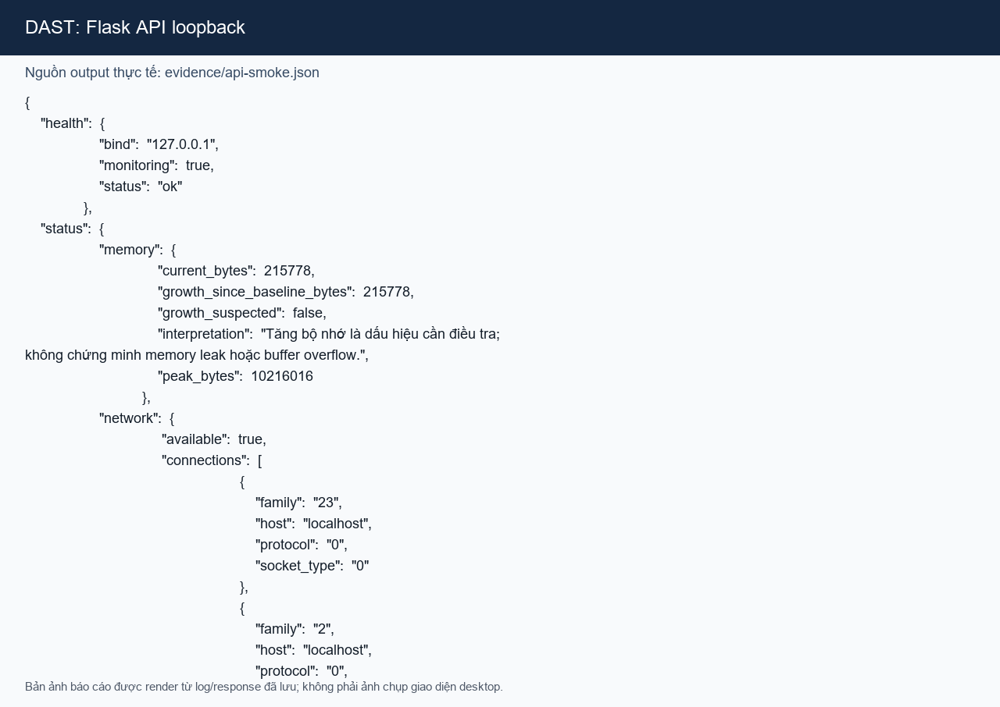
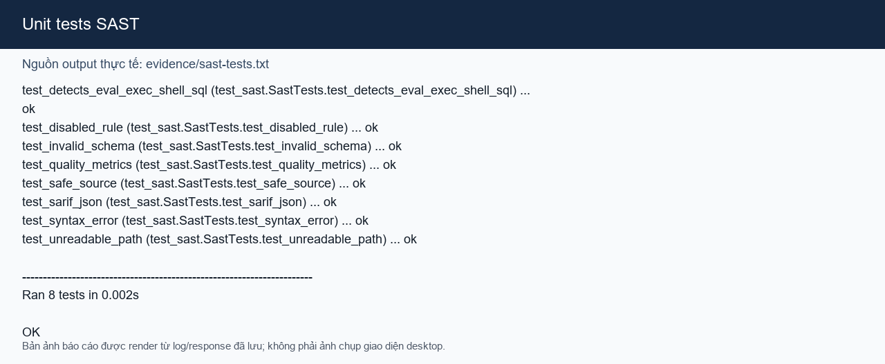
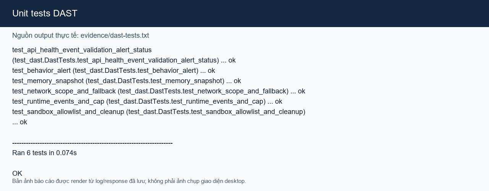
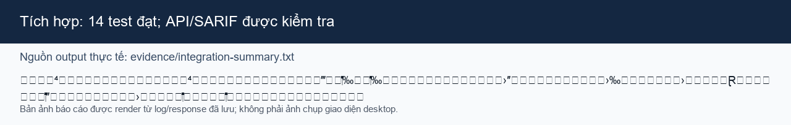

# Buổi 5 — Phân tích và kiểm thử bảo mật (SAST + DAST)

**Sinh viên:** Nguyễn Phúc Thịnh

**MSSV:** 2387700066

**Đề bài:** `lab-05.pdf`, các mục 5.1–5.4.

Bài thực hành triển khai bộ phân tích mã tĩnh SAST cho Python và nền tảng phân tích động DAST phục vụ học tập. SAST quét cấu trúc AST mà không chạy mã nguồn; DAST quan sát sự kiện và chỉ số của ứng dụng demo đang chạy. Các ví dụ nguy hiểm chỉ được quét tĩnh, không thực thi.

## 1. Môi trường

Đã xác minh trên Windows với Python 3.11.9, pip 24.0, Git 2.55.0.windows.5 và Flask 3.1.3. Đề bài PDF đã được đọc. Flask là dependency chạy; Pillow được dùng riêng để render ảnh minh chứng từ output đã lưu.



Ảnh tổng hợp môi trường đã dùng. Thông tin nguồn được lưu trong `evidence/environment.txt`.

## 2. Cấu trúc thư mục

```text
Buoi5/
├── sast-tool/
│   ├── examples/             # Mẫu an toàn và mẫu nguy hiểm để quét tĩnh
│   ├── rules/                # Rule JSON
│   ├── sast_tool/            # AST, matcher, rule engine, quality, SARIF, CLI
│   └── tests/
├── dast-tool/                # Runtime, memory, network, behavior, sandbox, API
│   └── tests/
├── screenshots/              # Ảnh minh chứng
├── evidence/                 # SARIF, output lệnh và phản hồi API
├── README.md
└── REPORT.md
```



Ảnh được tạo từ danh sách thư mục thực tế; danh sách nguồn nằm trong `evidence/project-structure.txt`.

## 3. Cài đặt

Từ thư mục `Buoi5`:

```powershell
python -m venv .venv
.\.venv\Scripts\python.exe -m pip install -r requirements-dev.txt
```

`requirements-dev.txt` cài Flask cho API và Pillow cho công cụ render ảnh. Virtual environment bị loại khỏi Git.

## 4. SAST — phân tích tĩnh

Chạy từ thư mục `Buoi5`:

```powershell
Push-Location sast-tool
..\.venv\Scripts\python.exe -X utf8 -m sast_tool.main examples\vulnerable_01.py --sarif ..\evidence\report.sarif --quality
..\.venv\Scripts\python.exe -X utf8 -m sast_tool.main examples\safe_example.py
Pop-Location
```

Analyzer dùng `ast` để tìm `eval`, `exec`, `os.system`, `subprocess` với `shell=True`, và mẫu SQL interpolation truyền tới `execute`. Rule được cấu hình trong `sast-tool/rules/default_rules.json`; mỗi rule có ID, severity, mô tả và trạng thái bật/tắt. Analyzer xử lý lỗi cú pháp và lỗi đọc file, không import hay thực thi file được quét.

Ví dụ nguy hiểm cho 3 phát hiện: `PY-SQL-FSTRING`, `PY-EVAL`, `PY-SHELL`. Ví dụ an toàn cho 0 phát hiện.



Đây là output thực tế của CLI đã lưu trong `evidence/sast-vulnerable.txt`; file mẫu chỉ được phân tích tĩnh.



Output thực tế trong `evidence/sast-safe.txt` xác nhận 0 phát hiện.

### Rule tùy chỉnh và chỉ số chất lượng

Rule engine nhận JSON có `version: 1` và danh sách `rules`; kiểm tra kiểu dữ liệu, ID trùng, severity và trường hỗ trợ. Có thể tắt rule bằng `"enabled": false` hoặc thêm rule gọi hàm theo cấu trúc hiện tại.

Code quality checker báo:

- **Cyclomatic complexity:** bắt đầu từ 1, cộng 1 cho mỗi nhánh/điều kiện trong hàm.
- **Function length:** số dòng từ khai báo hàm đến dòng cuối thân hàm.
- **Nested depth:** mức lồng tối đa của cấu trúc điều khiển.
- **Dependency count:** số tên module import duy nhất.
- **Security smell density:** số phát hiện trên 100 dòng mã.

Đây là heuristic định hướng review, không phải thước đo chuẩn hóa.

### SARIF

SARIF được ghi tại [`evidence/report.sarif`](evidence/report.sarif). JSON đã được nạp lại và xác nhận phiên bản 2.1.0 cùng 3 kết quả; mỗi kết quả có rule ID, mức độ, thông điệp và vị trí dòng.



Có thể mở file bằng SARIF Viewer hoặc trình soạn thảo JSON.

### Giới hạn SAST

Phân tích SQL theo dõi trực tiếp biến được gán từ f-string/biểu thức nối chuỗi trước khi gọi `execute`; đây không phải taint analysis tổng quát, không theo dõi alias, luồng liên hàm hay mọi nhánh điều kiện. Công cụ có thể bỏ sót hoặc cảnh báo nhầm.

## 5. DAST — phân tích động

Chạy demo dữ liệu tổng hợp an toàn:

```powershell
Push-Location dast-tool
..\.venv\Scripts\python.exe -X utf8 main.py
Pop-Location
```

Các thành phần gồm:

- **RuntimeMonitor:** ghi sự kiện có timestamp UTC, metadata và giới hạn số sự kiện lưu.
- **MemoryAnalyzer:** đo allocation Python bằng `tracemalloc` và báo mức tăng nghi vấn.
- **NetworkTrafficAnalyzer:** chỉ ghi metadata demo/loopback; không bắt payload hay sniff lưu lượng hệ thống.
- **SecurityBehaviorChecker:** so khớp sự kiện với rule cảnh báo và giải thích lý do.
- **VirtualSandbox:** chỉ chạy snippet allow-list, có timeout, giới hạn output và dọn thư mục tạm.



Output demo thực tế được lưu tại `evidence/dast-demo.json`; sandbox kết thúc với mã 0 và thư mục tạm được dọn.

### Flask API

Khởi động từ `Buoi5`:

```powershell
Push-Location dast-tool
..\.venv\Scripts\python.exe -X utf8 app.py
# Dừng bằng Ctrl+C
```

API mặc định chỉ bind `127.0.0.1:5055`, tắt debug. Các endpoint:

| Method | Đường dẫn | Chức năng |
|---|---|---|
| GET | `/api/health` | Trạng thái service và monitor |
| GET | `/api/status` | Snapshot bộ nhớ và metadata mạng |
| GET | `/api/events?limit=100` | Sự kiện gần nhất; `limit` từ 1 đến 200 |
| GET | `/api/alerts` | Cảnh báo theo rule |
| POST | `/api/demo/event` | Thêm sự kiện demo thuộc allow-list |

Ví dụ PowerShell:

```powershell
Invoke-RestMethod http://127.0.0.1:5055/api/health
Invoke-RestMethod http://127.0.0.1:5055/api/status
Invoke-RestMethod -Method Post -Uri http://127.0.0.1:5055/api/demo/event `
  -ContentType 'application/json' -Body '{"type":"command.shell"}'
Invoke-RestMethod http://127.0.0.1:5055/api/alerts
```

Kiểm tra HTTP trên server loopback thực tế: health 200, status 200, gửi demo event 201, alerts 200 và `limit=999` trả 400. Kết quả được lưu trong `evidence/api-smoke.json`.



Endpoint demo chỉ nhận `process.spawn`, `command.shell`, `demo.normal`; endpoint không thực thi shell/Python và không cung cấp thao tác đọc/ghi file tùy ý.

### Giới hạn DAST và sandbox

`tracemalloc` chỉ quan sát allocation Python; tăng bộ nhớ không chứng minh memory leak và không phát hiện buffer overflow cấp native. Network analyzer không sniff packet. Sandbox dùng subprocess, thư mục tạm và timeout nhưng vẫn chạy cùng tài khoản hệ điều hành; không có cô lập syscall, filesystem hay network như VM/container. Không dùng để chạy malware hoặc mã không tin cậy. Flask development server chỉ dùng trong lab local.

## 6. Kiểm thử

Chạy unit tests:

```powershell
Push-Location sast-tool
..\.venv\Scripts\python.exe -X utf8 -m unittest discover -s tests -v
Pop-Location
Push-Location dast-tool
..\.venv\Scripts\python.exe -X utf8 -m unittest discover -s tests -v
Pop-Location
```

Kết quả đã chạy: **SAST 8/8 PASS**, **DAST 6/6 PASS**, tổng **14 PASS, 0 FAIL, 0 SKIP**. Test bao gồm phát hiện và file an toàn, lỗi cú pháp/cấu hình, SARIF, quality metrics, runtime, memory, network scope, cảnh báo, sandbox và API.







Output test gốc nằm trong `evidence/sast-tests.txt` và `evidence/dast-tests.txt`; script `evidence/capture_test_output.py` chạy lại và lưu output UTF‑8.

## 7. Danh mục ảnh minh chứng

Các PNG dưới đây là ảnh báo cáo được render từ output lệnh/HTTP thực tế đã lưu. Chúng không phải ảnh chụp giao diện desktop; nội dung nguồn được ghi trên từng ảnh và nằm trong `evidence/`. Mỗi ảnh đã được mở kiểm tra và xác minh là PNG hợp lệ.

| File | Nội dung | Trạng thái |
|---|---|---|
| `01-environment.png` | Python, Git, Flask và PDF đề bài | VERIFIED |
| `02-project-structure.png` | Cấu trúc project | VERIFIED |
| `03-sast-vulnerabilities.png` | Phát hiện SAST trên mẫu nguy hiểm | VERIFIED |
| `04-sast-safe.png` | Quét mẫu an toàn | VERIFIED |
| `05-sarif-verified.png` | SARIF 2.1.0 và 3 kết quả | VERIFIED |
| `06-sast-tests.png` | 8 unit tests SAST | VERIFIED |
| `07-dast-runtime-demo.png` | Runtime, memory và sandbox | VERIFIED |
| `09-api-smoke.png` | Phản hồi Flask API loopback | VERIFIED |
| `10-dast-tests.png` | 6 unit tests DAST | VERIFIED |
| `11-integration-summary.png` | Kết quả tổng hợp | VERIFIED |

## 8. Kết luận

Đã triển khai các thành phần chính theo mục 5.1–5.4, quét được mẫu nguy hiểm, tạo SARIF hợp lệ, chạy API local và hoàn tất 14 unit tests. SAST và DAST bổ trợ nhau: SAST kiểm tra cấu trúc mã trước khi chạy; DAST quan sát các hành vi đã instrument trong lúc ứng dụng demo chạy. Các giới hạn về dataflow, giám sát hệ thống và cô lập sandbox được nêu rõ để tránh hiểu prototype học tập thành công cụ production.
