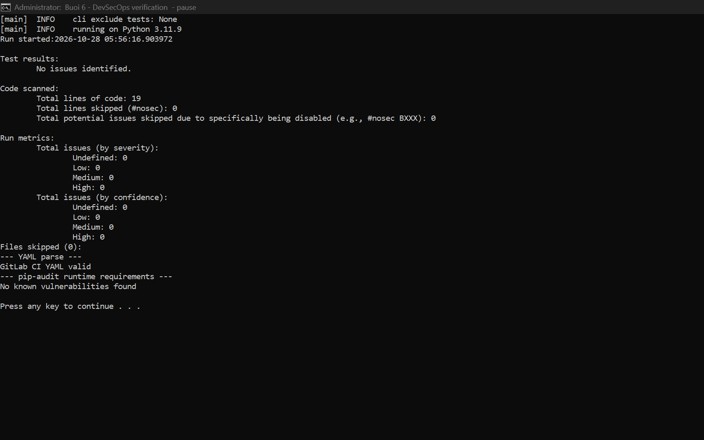

# Buổi 6 — DevSecOps và CI/CD an toàn

**Sinh viên:** Nguyễn Phúc Thịnh<br>
**MSSV:** 2387700066<br>
**Đề bài:** `lab-06.pdf` — bảo mật DevSecOps, pipeline CI/CD GitLab, kiểm thử tự động và IaC.

## Mục tiêu

Thực hành security gates theo hướng shift-left trên ứng dụng Flask nhỏ. Pipeline GitLab định nghĩa các bước kiểm tra theo thứ tự: validate cấu hình, unit test, SAST, quét dependency và secrets, DAST, kiểm tra cấu hình container rồi build và quét image. Job deploy production chưa bật vì cần môi trường cùng thông tin xác thực do chủ dự án cấu hình.

## Cấu trúc

```text
Buoi6/
├── .gitlab-ci.yml       # Pipeline DevSecOps
├── app.py               # Ứng dụng Flask demo
├── test_app.py          # Kiểm tra endpoint
├── requirements.txt     # Dependency runtime
├── requirements-dev.txt # Dependency phục vụ kiểm tra
├── Dockerfile           # Image chạy bằng user không đặc quyền
├── .dockerignore
├── evidence/            # Log thực thi và ảnh CMD
├── screenshots/         # Ảnh chụp màn hình minh chứng
└── README.md
```

## Chạy ứng dụng và kiểm thử cục bộ

Yêu cầu Python 3.11 trở lên. Từ thư mục `Buoi6`:

```powershell
python -m venv .venv
.\.venv\Scripts\python.exe -m pip install -r requirements-dev.txt
.\.venv\Scripts\python.exe -m pytest -q
.\.venv\Scripts\python.exe -m bandit -r app.py -ll
.\.venv\Scripts\python.exe -m pip install pip-audit
.\.venv\Scripts\python.exe -m pip_audit -r requirements.txt
```

Khởi chạy ứng dụng:

```powershell
.\.venv\Scripts\python.exe -m flask --app app run --host 127.0.0.1 --port 8000
```

Endpoint kiểm tra sức khỏe: `http://127.0.0.1:8000/health`.

## Các security gates

| Giai đoạn | Công cụ | Mục đích |
|---|---|---|
| Validate | PyYAML | Đọc cấu hình pipeline và phát hiện YAML lỗi |
| Test | pytest | Xác minh endpoint và dữ liệu trả về |
| SAST | Bandit | Phân tích mã Python tĩnh, ngưỡng medium trở lên |
| SCA | pip-audit | Kiểm tra dependency runtime với advisory đã biết |
| Secret scan | Gitleaks | Dò secret trong source checkout; redact kết quả |
| IaC | Checkov | Kiểm tra Dockerfile theo rule cấu hình an toàn |
| DAST | OWASP ZAP baseline | Quét thụ động ứng dụng đang chạy trong container; lưu HTML report |
| Image scan | Trivy | Chặn image có CVE mức High/Critical; push image chỉ từ nhánh mặc định |

Job bảo mật thất bại sẽ chặn các stage sau. Artifact báo cáo ZAP được lưu một tuần. GitLab runner cần hỗ trợ Docker-in-Docker cho DAST và build image. GitLab Registry phải bật để push image. Không dùng biến bí mật trong source; khai báo deploy credentials dưới dạng CI/CD variables masked/protected và chỉ thêm job deploy khi đã cấu hình protected environment.

## Chạy pipeline

1. Tạo hoặc chọn một project GitLab và thêm remote GitLab nếu muốn chạy pipeline trên GitLab.
2. Push nhánh có `.gitlab-ci.yml`; GitLab sẽ tự tạo pipeline cho commit/merge request.
3. Xem log từng job tại **Build → Pipelines**. Tải `zap-report.html` ở artifacts của job `dast-zap`.
4. Đảm bảo runner cho phép Docker-in-Docker; nếu chính sách runner không cho privileged mode, thay các job container bằng runner phù hợp.

> [!NOTE]
> Repository GitHub môn học lưu bài và mã nguồn. File `.gitlab-ci.yml` là cấu hình dành cho GitLab CI, không tự chạy trên GitHub Actions. Pipeline online chỉ được xác nhận khi có project GitLab và runner hoạt động; README không khẳng định job đã chạy trên GitLab.

## Bảo vệ pipeline và giới hạn

- Bật MFA, giới hạn quyền maintain pipeline, bảo vệ nhánh mặc định và yêu cầu review thay đổi `.gitlab-ci.yml`.
- Không chạy pipeline từ fork với secrets/runner đặc quyền; tách runner không tin cậy khỏi runner deploy.
- Gitleaks trong job này quét working tree, không quét toàn bộ lịch sử Git. Có thể mở rộng bằng secret scanning được quản lý ở cấp project.
- Bandit và ZAP baseline là công cụ sàng lọc tự động; kết quả cần được review. ZAP baseline thiên về passive checks, không thay thế pentest.
- `pip-audit` chỉ kiểm tra dependency được liệt kê trong `requirements.txt`; cần lock file và quy trình cập nhật định kỳ cho triển khai thực tế.
- Bài tập không triển khai production; không có credential hay secret thật trong repo.

## Minh chứng

Kết quả thực thi cục bộ được lưu tại [`evidence/security-checks.txt`](evidence/security-checks.txt). Ảnh sau được chụp trực tiếp từ màn hình CMD khi hiển thị kết quả kiểm tra:



Các minh chứng chỉ ghi nhận thao tác đã thực thi cục bộ; trạng thái GitLab CI cần đối chiếu trên project GitLab.
