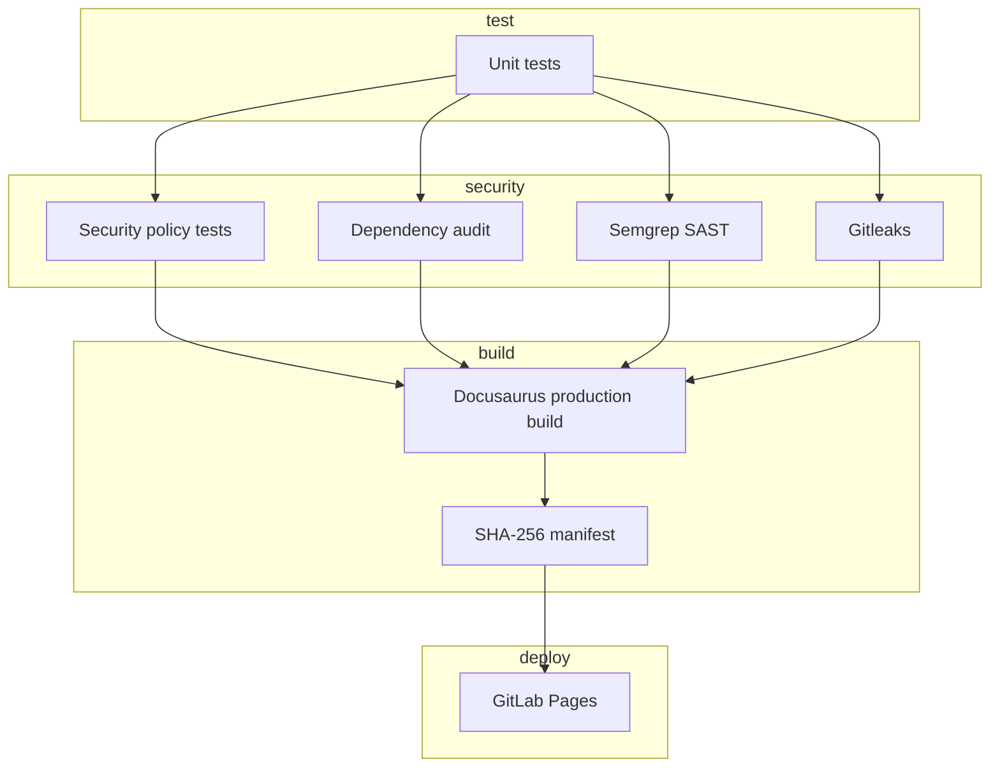

# Pipeline nhiều giai đoạn

Pipeline được tách thành bốn stage nhằm làm rõ thứ tự và failure boundary.

| Stage | Job | Kết quả |
|---|---|---|
| `test` | `unit-tests` | Node test report, chặn pipeline khi lỗi |
| `security` | `security-check`, `dependency-audit`, `semgrep`, `secret-scan` | Chặn khi scanner báo finding theo policy |
| `build` | `build-job` | Static site cùng manifest SHA-256 |
| `deploy` | `pages` | Publish artifact từ nhánh mặc định |

Semgrep và Gitleaks chạy bằng image scanner riêng, không cài công cụ đó vào site dependencies. Pipeline GitHub bổ sung build/test như kiểm tra repo, nhưng không tự tuyên bố đã xuất bản GitLab Pages.
