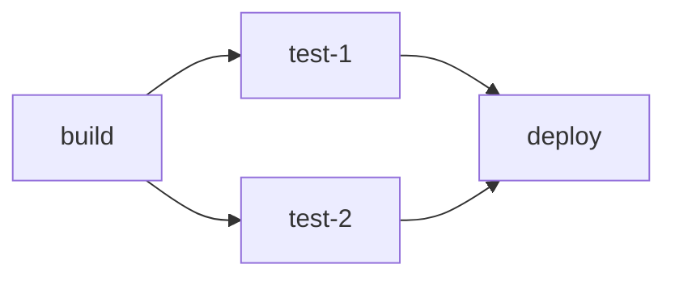

# 6.2 · Thực hành CI/CD với GitLab

Tài liệu PDF hướng dẫn pipeline đơn giản, sau đó build Docusaurus và triển khai GitLab Pages. Thư mục `examples/` có các cấu hình rút gọn để quan sát từng bước; pipeline tại `.gitlab-ci.yml` kết hợp test, kiểm tra bảo mật, build và Pages.

## Điều kiện

- GitLab project có quyền tạo/sửa pipeline.
- Runner hoạt động. GitLab-hosted runner hoặc runner do quản trị viên đăng ký.
- Node.js 22+ trên máy cá nhân để chạy lại build.
- Để triển khai Pages, bật Pages cho project và dùng nhánh mặc định.

## Bước 1 — pipeline đầu tiên

Ví dụ tối thiểu trong [`examples/first.gitlab-ci.yml`](../examples/first.gitlab-ci.yml):

```yaml
hello-job:
  script:
    - echo "Hello, $GITLAB_USER_LOGIN!"
    - date
```

Commit file cấu hình để runner chạy job, sau đó xem log tại **Build → Pipelines → job**.

## Bước 2 — job và stage

[`examples/basic.gitlab-ci.yml`](../examples/basic.gitlab-ci.yml) có bốn job: một job build, hai job test song song và một job deploy. Các job cùng stage chạy song song; stage tiếp theo chờ stage trước thành công.



## Bước 3 — Docusaurus build artifact

Pipeline chính chạy `npm ci` và `npm run build`. Docusaurus sinh website tĩnh vào `Buoi6/build/`; job build lưu thư mục này thành artifact để job Pages dùng lại.

## Bước 4 — GitLab Pages

Project lớp này lưu cấu hình tại `Buoi6/.gitlab-ci.yml`, không ở root của toàn repo môn học. Nếu tạo project GitLab từ cả repo, vào **Settings → CI/CD → General pipelines → CI/CD configuration file** và đặt `Buoi6/.gitlab-ci.yml`. Khi dùng repository riêng chỉ chứa nội dung Buoi6, có thể đặt file thành `.gitlab-ci.yml` ở root project.

Job `pages` lấy artifact từ `build-job`, chuyển `Buoi6/build/` thành `public/` và chỉ chạy trên nhánh mặc định. URL Pages thật chỉ có sau khi pipeline chạy thành công và Pages đã bật trong GitLab project.

## Bước 5 — chạy cục bộ

```powershell
cd Buoi6
npm ci
npm test
npm run security
npm audit --audit-level=high
npm run build
```

Mở preview cục bộ bằng `npm run serve`. Những kết quả trên máy cá nhân không được mô tả thành trạng thái runner hoặc Pages online.
