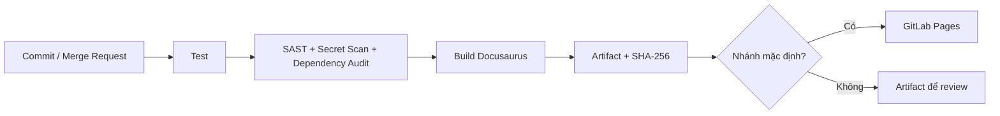

# Bài 6 — Bảo mật với DevSecOps

**Sinh viên:** Nguyễn Phúc Thịnh · **MSSV:** 2387700066<br />
**Môn học:** Thực hành Lập trình An toàn Thông tin<br />
**Tài liệu:** [`lab-06.pdf`](https://github.com/pthink21/THLTANTT_2387700066_NPT/blob/main/Buoi6/lab-06.pdf)

## Mục tiêu

Bài thực hành đưa các kiểm tra bảo mật vào vòng đời CI/CD để lỗi được phát hiện trước khi phát hành. Phần triển khai có website Docusaurus, pipeline GitLab với các stage tuần tự, các ví dụ cấu hình cơ bản và security gates bổ sung.

## Sản phẩm

| Thành phần | Nội dung |
|---|---|
| Website tài liệu | Docusaurus, có hướng dẫn, pipeline diagram, responsive layout |
| Bài tập GitLab | Job đầu tiên, pipeline bốn job và ví dụ build/deploy Pages |
| Security gates | Unit test, kiểm tra cấu hình, secret scan và dependency audit |
| Artifact | Thư mục `build/` và manifest SHA-256 |
| Minh chứng | 20 ảnh CMD được chụp trong lúc chạy lệnh thực tế |

## Quy trình tổng quát



Các job nằm ở stage sau chỉ được bắt đầu sau khi stage trước thành công. `pages` chỉ chạy trên nhánh mặc định. Pipeline không đặt credential trong mã nguồn.

## Bắt đầu nhanh trên Windows

Yêu cầu Node.js 22 trở lên và npm. Chạy trong CMD hoặc PowerShell từ thư mục `Buoi6`:

```powershell
npm ci
npm test
npm run security
npm audit --audit-level=high
npm run build
npm run checksums
```

Xem hướng dẫn chi tiết tại [Thực hành GitLab CI/CD](./gitlab-cicd), [pipeline bảo mật](./secure-pipeline) và [kết quả/minh chứng](./results).
